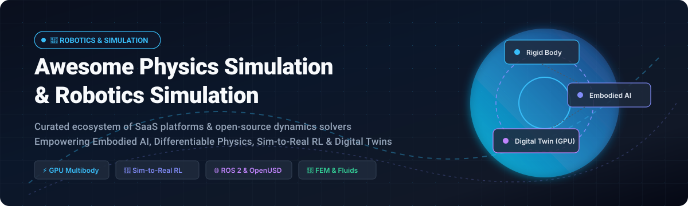

# 🌌 Awesome-Physics-Simulation-Engine-Robotics-Simulation 🤖

<p align="center">
  
</p>

<p align="center">
  <a href="https://github.com/ishandutta2007/Awesome-Awesome-Awesome"></a><a href="https://discord.gg/jc4xtF58Ve"></a>
  <a href="https://github.com/ishandutta2007/Awesome-Physics-Simulation-Engine-Robotics-Simulation"></a>
  <a href="https://github.com/ishandutta2007/Awesome-Physics-Simulation-Engine-Robotics-Simulation/fork"></a>
  <a href="https://github.com/ishandutta2007/Awesome-Physics-Simulation-Engine-Robotics-Simulation/graphs/contributors"></a>
  <a href="https://github.com/ishandutta2007/Awesome-Physics-Simulation-Engine-Robotics-Simulation/blob/main/LICENSE"></a>
  <a href="https://github.com/ishandutta2007"></a>
</p>

---

## 🧭 Curated Directory of Physics Simulation Engines & Robotics Simulation Platforms

Welcome to the definitive **SEO-optimized, curated guide** for **Physics Simulation Engines**, **Robotics Simulators**, **Embodied AI Platforms**, and **Digital Twins**. Whether you are building humanoid control policies with reinforcement learning (RL), executing high-fidelity finite element analysis (FEA), validating multi-body dynamics, simulating complex sensor arrays (LiDAR/Radar/Depth), or architecting industrial robot fleet operations (RobOps), this directory indexes industry-leading SaaS platforms and high-performance open-source GitHub dynamics engines.

---

## 📑 Table of Contents
- [📊 Sector Overview & Market Dynamics](#-sector-overview--market-dynamics)
- [☁️ SaaS & Hosted Simulation Platforms](#️-saas--hosted-simulation-platforms)
- [🔓 Open-Source GitHub Projects](#-open-source-github-projects)
- [🛠️ Architectural Cheat Sheet & Selection Guide](#️-architectural-cheat-sheet--selection-guide)
- [🤝 How to Contribute](#-how-to-contribute)
- [💖 Support & Sponsoring](#-support--sponsoring)
- [📈 Star History](#-star-history)
- [⚖️ Disclaimer](#️-disclaimer)

---

## 📊 Sector Overview & Market Dynamics

The global robotics simulation and digital twin market is valued at approximately **$2.2B for specialized robotics simulation** and exceeds **$49.5B across the broader digital twin and multi-physics CAE ecosystem**, expanding at a rapid **16.2% to 31.1% CAGR** driven by the exponential rise of **Physical AI, humanoid robotics, and synthetic sim-to-real training pipelines**.

The sector exhibits **moderate fragmentation with high concentration at the foundational compute and solver layers**: hyperscale ecosystem orchestrators (NVIDIA, Microsoft, Ansys, MathWorks) dominate cloud rendering, GPU runtime infrastructure, and enterprise CAD/CAE validation, while a dynamic, highly specialized wave of venture-backed autonomous mobility platforms (Applied Intuition) and modern open-source differentiable dynamics engines (Genesis, MuJoCo, Taichi, Isaac Lab) capture the bleeding-edge developer mindshare for embodied AI and reinforcement learning.

---

## ☁️ SaaS & Hosted Simulation Platforms

The table below catalogs premier commercial SaaS, managed cloud, and enterprise hosted platforms for physics simulation and robotics engineering, **sorted in descending order by Company Size (Market Cap / Valuation / ARR)**:

| 🏷️ Platform | 🏢 Company Size (Valuation / Market Cap / Rev) | 💰 Pricing (Starting Tier) | 🎁 Free Tier Limit / Evaluation | 🎯 Primary Domain & Physics Capabilities |
| :--- | :--- | :--- | :--- | :--- |
| **[Microsoft (Havok Physics & Cloud)](https://havok.com)** | **~$3.10T** (Market Cap) | **$50,000 flat per title** (Studios with project budget under $20M; royalty-free, no per-seat fees) | **Free Evaluation for Qualified Studios** (Full pre-compiled binary SDK access upon studio registration; non-commercial student learning through partner academic engines) | Industry-standard real-time collision detection, rigid-body mechanics, ragdoll kinematics, and destruction physics for AAA simulations. |
| **[NVIDIA Omniverse Cloud & Isaac Sim](https://nvidia.com)** | **~$3.00T** (Market Cap) | **$4,500/GPU/year** (or ~$1.00/GPU/hour consumption via CSP Marketplaces + cloud compute infrastructure) | **Free Core Tier Forever** (NVIDIA Omniverse core application & workstation tools are 100% free for individual developers, researchers, and commercial evaluation) | Cloud-native OpenUSD digital twin platform with GPU-parallel PhysX and Isaac Sim for physical AI, multi-robot factories, and sensor simulation. |
| **[Ansys Autonomy & Digital Twin Cloud](https://ansys.com)** | **~$28.0B** (Market Cap / Enterprise Valuation) | **~$1,000/quarter** (Cloud platform baseline access) + Ansys Elastic Currency (~$10,000–$35,000/yr for commercial solver licenses) | **30-Day Free Trial** (Includes Ansys Cloud burst compute credits, interactive browser sessions, and complete multiphysics solver access) | Comprehensive multiphysics solvers (FEA, CFD, electromagnetics), AV sensor-physics (LiDAR, radar), and hardware-in-the-loop (HIL) cloud validation. |
| **[Applied Intuition (Simian / Spectral / Oasis)](https://appliedintuition.com)** | **~$30.0B** (Valuation, 2026; ~$830M+ ARR) | **~$50,000–$100,000+/year** (Enterprise platform annual subscription customized by simulation vehicle count and synthetic test miles) | **Bespoke Enterprise POC / Trial** (14-to-30 day scoped pilot environment including sensor-physics test suites and synthetic scenario editor for automotive & defense teams) | End-to-end cloud vehicle dynamics, synthetic sensor generation, and safety validation for autonomous vehicles, defense systems, and mobile robotics. |
| **[MathWorks Simscape & MATLAB Online](https://mathworks.com)** | **~$1.5B+** (Annual Revenue; Privately Held) | **$1,015/year** (Standard commercial annual license for base MATLAB/Simulink + Simscape domain add-ons; $49–$99/yr for verified students) | **30-Day Free Trial** (Full-featured access to MATLAB Online, Simulink, Simscape Multibody, Electrical, and Fluids with 20 GB cloud storage) | Acausal physical modeling, multi-domain system dynamics (mechanical, electrical, hydraulic), and automated C/C++ control code generation. |
| **[Cognite / SimScale Cloud Simulation](https://simscale.com)** | **~$100M+** (Private / Venture Backed) | **$2,400/year** (Professional Tier for private projects, advanced GPU compute, and dedicated support) | **Free Community Plan Forever** (Unlimited public simulation projects, up to 10 quantitative simulations/yr + 3,000 core-hours/year, qualitative viewing thereafter) | 100% cloud-native browser FEA, Computational Fluid Dynamics (CFD), and thermal dissipation analysis running on scalable cloud clusters. |
| **[Formant Cloud Robotics](https://formant.io)** | **~$50M–$100M** (Series B Funded) | **~$250/robot/month** (Enterprise fleet management with advanced teleoperation, data pipelining, and long-term retention) | **Free Forever Tier for Developers** (Connect up to 2 active robots/devices forever with real-time telemetry streaming, ROS diagnostics, and remote command dispatch) | Cloud robot operations (RobOps), digital twin observability, simulated physics replay, and telemetry monitoring for autonomous mobile fleets. |
| **[InOrbit Cloud RobOps](https://inorbit.ai)** | **~$20M–$50M** (Venture Backed) | **$1,000/year** (Developer Edition covering up to 8 robots with advanced teleoperation; custom enterprise quotes for scaled fleets) | **Free Edition Forever** (Supports unlimited robots forever for essential fleet tracking, standard telemetry collection, incident alerts, and dashboard views) | Fleet-wide digital twin tracking, spatial robot telemetry playback, mission dispatching, and live incident triage across multi-vendor robot fleets. |
| **[CoppeliaSim Edu / Pro (Coppelia Robotics)](https://coppeliarobotics.com)** | **Boutique Independent** (Self-Sustaining Leader) | **$1,490 one-time perpetual** (CoppeliaSim Pro commercial license per seat including 1 year of software updates & support) | **Free Edu License Forever** (100% full software functionality without feature caps or watermarks, permanently free for students, teachers, and university research) | Flexible robotics simulation laboratory featuring swappable physics backends (MuJoCo, Bullet, ODE, Newton), ROS 2 bridge, and distributed API client libraries. |

---

## 🔓 Open-Source GitHub Projects

The following table lists top open-source physics engines, robotics simulators, and embodied AI frameworks, **sorted in descending order by GitHub Star count**. Each star badge links directly to the stargazer community of that project:

| 🌟 Open-Source Repository | ⭐ GitHub Star Count | 📝 Description & Architectural Highlights |
| :--- | :--- | :--- |
| **[Genesis-Embodied-AI/genesis-world](https://github.com/Genesis-Embodied-AI/genesis-world)** | [](https://github.com/Genesis-Embodied-AI/genesis-world/stargazers) | Next-generation generative physics platform written in pure Python; unifies rigid bodies, MPM, SPH fluids, FEM soft bodies, and differentiable GPU physics. |
| **[taichi-dev/taichi](https://github.com/taichi-dev/taichi)** | [](https://github.com/taichi-dev/taichi/stargazers) | Domain-specific programming language embedded in Python designed for high-performance, GPU-accelerated physical simulations, MPM sand/snow, and fluid solvers. |
| **[google-deepmind/mujoco](https://github.com/google-deepmind/mujoco)** | [](https://github.com/google-deepmind/mujoco/stargazers) | Multi-Joint dynamics with Contact; high-performance C physics simulator with MJX (hardware-accelerated JAX solver for millions of parallel steps on GPU/TPU). |
| **[bulletphysics/bullet3](https://github.com/bulletphysics/bullet3)** | [](https://github.com/bulletphysics/bullet3/stargazers) | Classic C++ collision detection and multi-body physics library powering `PyBullet` for robotics manipulation, inverse kinematics, and machine learning. |
| **[jrouwe/JoltPhysics](https://github.com/jrouwe/JoltPhysics)** | [](https://github.com/jrouwe/JoltPhysics/stargazers) | Multi-core friendly modern C++ rigid-body physics and collision detection engine engineered for extreme throughput (used in Horizon Forbidden West & Death Stranding 2). |
| **[erincatto/box2d](https://github.com/erincatto/box2d)** | [](https://github.com/erincatto/box2d/stargazers) | The canonical 2D rigid-body dynamics engine in C++; widely leveraged for path-planning benchmarks, algorithmic robotics prototypes, and foundational physics research. |
| **[isaac-sim/IsaacLab](https://github.com/isaac-sim/IsaacLab)** | [](https://github.com/isaac-sim/IsaacLab/stargazers) | Unified, modular open-source robot learning framework built on NVIDIA Isaac Sim for massively parallel reinforcement learning and imitation learning. |
| **[NVIDIA/warp](https://github.com/NVIDIA/warp)** | [](https://github.com/NVIDIA/warp/stargazers) | Open-source Python framework for writing high-performance differentiable spatial computing and custom physics/FEM/MPM simulation kernels on NVIDIA CUDA GPUs. |
| **[dimforge/rapier](https://github.com/dimforge/rapier)** | [](https://github.com/dimforge/rapier/stargazers) | Fast, deterministic 2D and 3D physics engine written completely in Rust, with first-class WebAssembly bindings, cross-platform reproducibility, and Bevy integration. |
| **[libigl/libigl](https://github.com/libigl/libigl)** | [](https://github.com/libigl/libigl/stargazers) | Header-only C++ geometry processing library providing critical mesh manipulation, continuous collision meshes, surface deformation, and spatial FEM utilities. |
| **[NVIDIA-Omniverse/PhysX](https://github.com/NVIDIA-Omniverse/PhysX)** | [](https://github.com/NVIDIA-Omniverse/PhysX/stargazers) | NVIDIA's flagship multi-threaded physics engine powering commercial digital twins, rigid/soft body simulation, particle dynamics, and vehicle simulation. |
| **[cyberbotics/webots](https://github.com/cyberbotics/webots)** | [](https://github.com/cyberbotics/webots/stargazers) | Turnkey 3D mobile robot simulation suite featuring realistic motor/sensor models, ODE dynamics, integrated ROS 2 controllers, and multi-robot environments. |
| **[google-deepmind/mujoco_menagerie](https://github.com/google-deepmind/mujoco_menagerie)** | [](https://github.com/google-deepmind/mujoco_menagerie/stargazers) | Curated collection of battle-tested, high-fidelity MJCF robot models (humanoids, quadrupedal dogs, robotic arms, and dextrous multi-fingered hands). |
| **[RobotLocomotion/drake](https://github.com/RobotLocomotion/drake)** | [](https://github.com/RobotLocomotion/drake/stargazers) | MIT/TRI toolbox for model-based design, trajectory optimization, contact-rich mechanics, Lyapunov stability analysis, and formal verification of robotic systems. |
| **[stack-of-tasks/pinocchio](https://github.com/stack-of-tasks/pinocchio)** | [](https://github.com/stack-of-tasks/pinocchio/stargazers) | Ultra-fast C++ library for rigid body dynamics computations and their analytical derivatives; the international standard for legged locomotion and whole-body control. |
| **[facebookresearch/habitat-sim](https://github.com/facebookresearch/habitat-sim)** | [](https://github.com/facebookresearch/habitat-sim/stargazers) | High-performance 3D simulator for embodied AI research capable of rendering photorealistic indoor scans at thousands of frames per second on modern GPUs. |
| **[mani-skill/ManiSkill](https://github.com/mani-skill/ManiSkill)** | [](https://github.com/mani-skill/ManiSkill/stargazers) | Benchmark and GPU-parallelized simulator for robotic manipulation with sensory observation spaces (point clouds, RGB-D) and sim-to-real transfer validation. |
| **[google/brax](https://github.com/google/brax)** | [](https://github.com/google/brax/stargazers) | Differentiable physics engine written in JAX; enables seamless end-to-end policy gradients and massively parallel reinforcement learning directly on GPUs/TPUs. |
| **[projectchrono/chrono](https://github.com/projectchrono/chrono)** | [](https://github.com/projectchrono/chrono/stargazers) | Multi-physics simulation engine specializing in wheeled/tracked off-road vehicle dynamics, granular terrain interactions (DEM), FEA, and fluid-structure coupling. |
| **[simbody/simbody](https://github.com/simbody/simbody)** | [](https://github.com/simbody/simbody/stargazers) | High-performance multibody dynamics library using internal coordinate formulations for biomechanical simulation (OpenSim), surgical robotics, and mechanisms. |
| **[OpenFOAM/OpenFOAM-dev](https://github.com/OpenFOAM/OpenFOAM-dev)** | [](https://github.com/OpenFOAM/OpenFOAM-dev/stargazers) | Leading free, open-source Computational Fluid Dynamics (CFD) solver package for complex aerodynamic, turbulent, and thermal multiphysics modeling. |
| **[stepjam/RLBench](https://github.com/stepjam/RLBench)** | [](https://github.com/stepjam/RLBench/stargazers) | Robot learning benchmark and simulation environment powered by PyRep/CoppeliaSim featuring 100+ highly varied vision-guided manipulation tasks. |
| **[allenai/ai2thor](https://github.com/allenai/ai2thor)** | [](https://github.com/allenai/ai2thor/stargazers) | Interactive 3D environment for embodied AI featuring near-photorealistic indoor rooms, physical object interactions, and task-oriented navigation. |
| **[gazebosim/gz-sim](https://github.com/gazebosim/gz-sim)** | [](https://github.com/gazebosim/gz-sim/stargazers) | The modern flagship open-source robotics simulator from Open Robotics (Gazebo Harmonic / Ionic) with native ROS 2 integration and modular physics backends. |
| **[sofa-framework/sofa](https://github.com/sofa-framework/sofa)** | [](https://github.com/sofa-framework/sofa/stargazers) | Real-time multi-physics simulation framework dedicated to soft tissue mechanics, surgical robotics simulation, and deformable object interaction via FEM. |
| **[dartsim/dart](https://github.com/dartsim/dart)** | [](https://github.com/dartsim/dart/stargazers) | Dynamic Animation and Robotics Toolkit; an accurate C++ multi-body kinematics and dynamics solver relying on generalized coordinates and Featherstone algorithms. |
| **[haosulab/SAPIEN](https://github.com/haosulab/SAPIEN)** | [](https://github.com/haosulab/SAPIEN/stargazers) | Realistic physics-rich embodied AI simulation platform supporting articulated PartNet objects, ray tracing, and high-performance camera sensor simulation. |
| **[StanfordVL/iGibson](https://github.com/StanfordVL/iGibson)** | [](https://github.com/StanfordVL/iGibson/stargazers) | Virtual simulation environment equipped with interactive photorealistic domestic scenes, physics-based object interactions, and virtual reality teleoperation support. |

---

## 🛠️ Architectural Cheat Sheet & Selection Guide

```
+----------------------------------------------------------------------------------------------------+
|                                    SELECTING YOUR PHYSICS ENGINE                                   |
+-----------------------------------+----------------------------------------------------------------+
| Primary Objective                 | Recommended Technology Stack                                   |
+-----------------------------------+----------------------------------------------------------------+
| Embodied AI & RL Training         | MuJoCo (MJX) ⚡ | Isaac Lab 🤖 | Genesis 🌌 | Brax 🏎️            |
| Mobile Manipulation & Benchmarks  | ManiSkill 🦾 | SAPIEN 📦 | RLBench 🎯                             |
| ROS 2 Industrial Robotics Sim     | Gazebo Harmonic (gz-sim) ⚙️ | Webots 🌐 | CoppeliaSim 🧪           |
| Biomechanics & Legged Locomotion  | Pinocchio 🦿 | Drake 📐 | Simbody 🦴                               |
| Deformable Bodies & Surgery       | SOFA Framework 🩺 | Warp FEM 🧬 | Genesis MPM 🌊                  |
| High-Speed Game Dynamics (C++/Rust)| Jolt Physics ⚡ | Rapier 🦀 | Box2D 🧱 | Bullet 🔫                 |
| Off-road Vehicles & Terramechanics| Project Chrono 🚜 | Simscape Multibody 🚗                          |
| Autonomous Fleet Cloud Operations | Applied Intuition 🚘 | Formant 🛰️ | InOrbit 📡                      |
+-----------------------------------+----------------------------------------------------------------+
```

---

## 🤝 How to Contribute

We actively welcome contributions from robotics engineers, game physics developers, researchers, and maintainers!

1. **Fork this repository** to your GitHub account.
2. **Create a descriptive branch**:
   ```bash
   git checkout -b feat/add-new-simulator
   ```
3. **Add or update an entry** in `README.md` respecting our table format:
   - For SaaS: Platform name, link, company size metrics, starting pricing tier, specific free tier limits, and capability summary.
   - For Open-Source: Repository name, star badge linked to stargazers, and architectural summary.
4. **Sort your entry correctly** (SaaS by Company Valuation/Market Cap descending; Open-Source by GitHub Stars descending).
5. **Commit your updates**:
   ```bash
   git commit -m "feat: add new physics simulation platform"
   ```
6. **Submit a Pull Request** describing the addition and verifying all links.

---

## 💖 Support & Sponsoring

If this curated simulation directory saved you research hours or helps accelerate your robotics and physical AI workflows, please consider supporting the project:

- ⭐ **Star this repository** to improve discoverability for other developers.
- 🍴 **Fork and share** with colleagues in robotics, game development, and simulation research.
- ☕ **Support the maintainer**: Buy a coffee or sponsor ongoing maintenance directly on the [GitHub Sponsors Dashboard](https://github.com/sponsors/ishandutta2007).

---

## 📈 Star History

##  Star History
#[](https://star-history.dera.page/#ishandutta2007/Awesome-Physics-Simulation-Engine-Robotics-Simulation&type=date&legend=top-left)`
[](https://www.star-history.com/#ishandutta2007/Awesome-Physics-Simulation-Engine-Robotics-Simulation&type=date&legend=top-left)`

---

## ⚖️ Disclaimer

- This is a community-curated directory intended for research, architectural planning, and educational purposes.
- All product names, logos, and brands are property of their respective owners. Mention does not constitute commercial endorsement.
- Simulation-to-real transfer fidelity (*the "sim-to-real gap"*) varies across contact models, numerical integration schemes, and actuator latencies. Always test policies in hardware-in-the-loop (HIL) environments with mechanical e-stops and safety protocols before physical deployment.

---

<p align="center">
  <sub>Engineered with ❤️ for robotics engineers, embodied AI researchers, and physics programmers worldwide.</sub>
</p>
